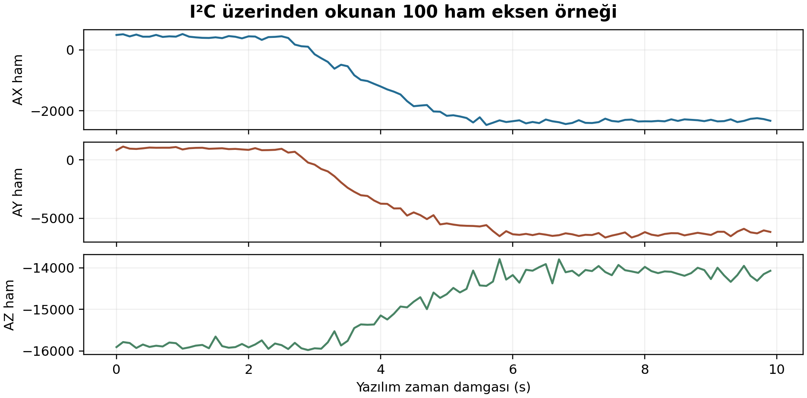

# Laboratuvar 3 — UART, I²C ve SPI Haberleşmesi

İleri Gömülü Sistemler dersi kapsamında standart ESP32 üzerinde UART geri döngüsü, baud uyumsuzluğu, I²C sensör okuma ve SPI geri döngüsü uygulamaları.

**Hazırlayan:** İbrahim Kaan Dalğar

## Donanım ve yazılım

- Standart ESP32 geliştirme kartı
- MPU-6050 olarak etiketlenmiş SY-104 modülü
- Jumper kablolar ve USB bağlantısı
- ESP-IDF v6.1 ve Windows üzerinde ESP-IDF terminali

Ders sunumundaki ESP32-S3 pinleri yerine standart ESP32 için uygun pinler seçilmiştir. Her bölüm ayrı yazılımla, sırayla çalıştırılmıştır. Kabloları değiştirirken USB gücü çıkarılmıştır.

## Sonuç özeti

| Deney | Sonuç |
|---|---|
| UART1 metin geri döngüsü, 115200 baud | 5/5 eşleşme |
| UART1 TX / UART2 RX, 115200 / 115200 | 3/3 eşleşme |
| UART1 TX / UART2 RX, 115200 / 9600 | 0/3 eşleşme; alınan baytlar `10 FD` |
| UART1 TX / UART2 RX, tekrar 115200 / 115200 | 3/3 eşleşme |
| I²C adres taraması | `0x68` adresinde tek cihaz |
| I²C WHO_AM_I | İlk okumada ve 10 tekrarda `0x72`; beklenen `0x68` ile uyuşmadı |
| I²C ham register okuma | 100 örnek; eğme sırasında eksen değerleri değişti |
| SPI mod 0, 1 MHz saat ayarı | 5/5 eşleşme |
| SPI mod 3, 1 MHz saat ayarı | 5/5 eşleşme |

## 1 UART

### Bağlantı

Tek jumper: **GPIO17 (kartta TX2) ↔ GPIO18 (D18)**.

İlk test UART1 üzerinden 115200 baud, 8 veri biti, eşliksiz ve 1 durma biti (8N1) ile çalışır. Her testte gönderilen ve alınan metin karşılaştırılır.

Baud karşılaştırmasında hızları bağımsız ayarlayabilmek için UART1 gönderici, UART2 alıcı olarak kullanılır. UART1 TX yine GPIO17, UART2 RX yine GPIO18'dir. GPIO16 kullanılmayan UART1 RX, GPIO19 kullanılmayan UART2 TX yönü için ayrılmıştır; bu iki pine kablo bağlanmaz. Konsol UART0 üzerinden izlenir.

Alıcının hızı 9600'e düşürüldüğünde 17 baytlık doğru metin yerine `10 FD` alınmış; alıcı 115200'e döndürüldüğünde iletişim düzelmiştir. Bozuk bayt dizisi bu denemeye aittir, her baud uyuşmazlığında aynı sonuç beklenmez.

## 2 I²C

| Modül pini | ESP32 |
|---|---|
| VCC | 3V3 |
| GND | GND |
| SDA | GPIO21 / D21 |
| SCL | GPIO22 / D22 |

XDA, XCL, AD0 ve INT bağlantısız bırakılmıştır. Veri yolu 100 kHz olarak ayarlanmıştır. Kod dahili pull-up'ları da etkinleştirir; fiziksel yükselme süresi ölçülmemiştir.

### Kimlik uyuşmazlığı

`0x68` I²C adresidir. `0x75` register'ından okunan **WHO_AM_I değeri `0x72`** olup MPU-6050 belgesindeki beklenen `0x68` değerinden farklıdır. On tekrarın tamamında aynı kimlik alınmıştır.

Modülün kesin modeli doğrulanmamıştır. Kimlik hatası gizlenmemiş; `0x72` için uyarı verilerek yalnız **MPU-6050 register düzeniyle uyumluluk denemesi** yapılmıştır. Başka kimliklerde test durdurulur.

Denemede `PWR_MGMT_1 (0x6B) = 0x01`, `ACCEL_CONFIG (0x1C) = 0x00` ve `CONFIG (0x1A) = 0x03` yazılmış; `0x3B` adresinden altı bayt okunarak üç işaretli 16 bit ham eksen değeri elde edilmiştir. Model ve ölçek doğrulanmadığı için sonuçlar g birimine dönüştürülmemiştir.

### Veri kaydı

`results/i2c_ivme_raw.csv` sütunları:

```csv
ornek,zaman_ms,ax_raw,ay_raw,az_raw
```

100 örnek, 0–9900 ms arasında 100 ms yazılım zaman damgası adımlarıyla kaydedilmiştir. Bu, sensörün iç örnekleme hızının ölçümü değildir. İlk örnek `487,840,-15908`, son örnek `-2327,-6181,-14072` değerlerindedir. Sensör eğildiğinde ham değerler değişmiştir.



Grafikteki üç panelin düşey ölçekleri farklıdır. Veriler kalibre edilmiş fiziksel ivme olarak yorumlanmamalıdır.

## 3 SPI

| İşlev | ESP32 pini | Harici bağlantı |
|---|---|---|
| MOSI | GPIO23 / D23 | GPIO19'a jumper |
| MISO | GPIO19 / D19 | GPIO23'e jumper |
| SCLK | GPIO18 / D18 | Boş |
| CS | GPIO5 / D5 | Boş |

SPI2_HOST üzerinde 1 MHz saat ayarıyla her işlemde **4 bayt = 32 bit** aktarılmıştır:

```text
A5 3C 0F F0
```

Mod 0 (CPOL=0, CPHA=0) ve mod 3 (CPOL=1, CPHA=1) için beşer testin tamamında alınan veri gönderilenle eşleşmiştir. Bu bir harici SPI cihazı uyumluluk testi değildir; aynı denetleyicinin gönderme ve alma yolları kullanılmaktadır.

## Çalıştırma

Güncel `lab3_haberlesme/main/main.c` dosyası SPI testini içerir.

ESP-IDF terminalinde `lab3_haberlesme` klasöründen:

```bash
idf.py build
idf.py -p COM7 flash monitor
```

COM7 yerine kartın bağlı olduğu portu kullanın. Monitörden çıkış: **Ctrl + ]**. Testi yeniden başlatmak için **EN / RESET** düğmesine basın.

### Bölüm kaynaklarını kullanma

İlgili yedek dosyanın içeriğini `main/main.c` dosyasına aktarın ve `main/CMakeLists.txt` dosyasını uygun bağımlılıklarla düzenleyin. Yedekleri koruyun.

| Test | results içindeki kaynak | REQUIRES |
|---|---|---|
| UART doğru baud geri döngü | `uart_dogru_baud_main.c` | `esp_driver_uart` |
| UART baud karşılaştırması | `uart_baud_karsilastirma_main.c` | `esp_driver_uart` |
| I²C sensör uyumluluk denemesi | `i2c_sensor_main.c` | `esp_driver_i2c esp_timer` |
| SPI mod 0 ve mod 3 | `spi_main.c` | `esp_driver_spi` |

SPI için `main/CMakeLists.txt`:

```cmake
idf_component_register(
    SRCS "main.c"
    INCLUDE_DIRS "."
    REQUIRES esp_driver_spi
)
```

C kaynak kodu **main.c** dosyasına yazılır; **CMakeLists.txt** yalnız derleme tanımını içerir.

## Dosyalar ve rapor

- `lab3_haberlesme/`: Güncel ESP-IDF projesi
- `results/`: Test çıktıları, bölüm kaynak kopyaları ve ham CSV
- `images/`: Devre fotoğrafları, terminal görüntüleri ve ham veri grafiği
- `rapor/`: Deney raporu

[Deney raporunu aç](rapor/Lab3_Deney_Raporu.pdf)

### Görsel dosya adları

- UART: `uart_devre.jpg`, `uart_dogru_baud.png`, `uart_ayni_baud.png`, `uart_yanlis_baud.png`, `uart_bauda_donus.png`
- I²C: `i2c_devre.jpg`, `i2c_kimlik.png`, `i2c_ivme_raw.png`, `i2c_ivme_grafik.png`
- SPI: `spi_devre.jpg`, `spi_mod0.png`, `spi_mod3.png`

`i2c_ivme_raw.png`, paylaşılan terminal metninden oluşturulmuş görseldir; doğrudan alınmış ekran görüntüsü değildir.

## Ölçüm sınırları

USB lojik analizör kullanılmamıştır. Yönergede istenen UART çerçeve çözümlemesi, I²C START/ACK/tekrarlı START ve SPI saat kenarı karşılaştırması fiziksel sinyaller üzerinden gerçekleştirilmemiştir. Terminal kayıtları, fotoğraf ve videolar bu ölçümlerin yerine geçmez.

I²C modülünün MPU-6050 kimliği doğrulanamadığından sensör okumaları ham register uyumluluk denemesi olarak sunulmuştur. Modül bozuk veya belirli başka bir model olarak sınıflandırılmamıştır.

## Kaynaklar

- Dersin Hafta 3 Haberleşme sunumu
- [Espressif ESP-IDF v6.1 belgeleri](https://docs.espressif.com/projects/esp-idf/en/v6.1/esp32/api-reference/)
- [MPU-6000/MPU-6050 register belgesi](https://invensense.tdk.com/wp-content/uploads/2015/02/MPU-6000-Register-Map1.pdf)
